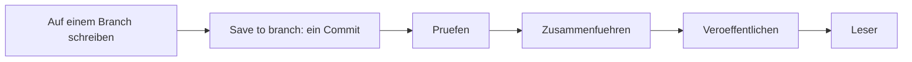

Dies ist der Teil des Produkts, der sich am stärksten vom editorzentrierten Projekttyp unterscheidet,
und der Teil, den man richtig verstehen sollte.

| Seite | Behandelt |
| :--- | :--- |
| [Branches und Prüfung](branches-and-review.md) | Wo Ihre Arbeit liegt, bevor sie veröffentlicht ist |
| [Veröffentlichen](publishing.md) | Wie eine Änderung die Leser erreicht |
| [Wenn zwei Personen bearbeiten](when-two-people-edit.md) | Konflikte, und warum sie kein Versagen sind |

## Die Gestalt davon

[d360]: # 'mermaid caption="Schreiben, Prüfen und Veröffentlichen sind drei getrennte Akte."'

[d360]: # "/mermaid"

> [!IMPORTANT]
> **Speichern ist nicht Veröffentlichen**
>
> In einem editorzentrierten Produkt können beide derselbe Moment sein. Hier behält Speichern einen Entwurf in
> Document360, Save to branch legt Ihre Arbeit ins Repository, und Leser sehen nichts, bis sie veröffentlicht ist. Dieser ganze Abschnitt
> handelt vom Abstand zwischen diesen beiden Ereignissen, und der ist beabsichtigt — dort findet die
> Prüfung statt.

## Warum ein Branch

Weil eine noch nicht fertige Änderung trotzdem gespeichert werden muss. Ein Branch lässt Sie einen
halb geschriebenen Artikel speichern, ohne dass dieser halb geschriebene Artikel für irgendjemanden
sichtbar wäre, der nicht gezielt danach sucht.

> [!NOTE]
> **Jede Autorin sieht, auf welchem Branch sie ist**
>
> Der Branch wird vor denen, die lieber nicht über Git nachdenken würden, nicht verborgen. Er wird
> gezeigt, weil zu wissen, wo Ihre Arbeit liegt, Teil davon ist zu wissen, ob sie sicher ist.

[d360]: # 'snippet name="deleteMe"'
