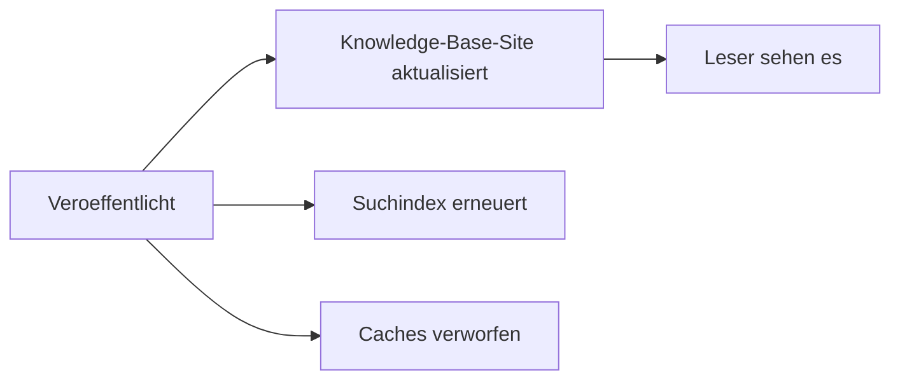

Veröffentlichen ist der Akt, der eine Änderung für Leser sichtbar macht. Er ist getrennt vom
Speichern und getrennt von der Prüfung, und diese drei auseinanderzuhalten ist das, was mehreren
Personen erlaubt, gleichzeitig an der Dokumentation zu arbeiten, ohne dass Leser die Mitte davon
sehen.

Publish sitzt in der oberen Leiste und veröffentlicht den **gesamten geöffneten Arbeitsbereich**:
jede ausstehende Änderung, gemeinsam live gestellt. Publish committet direkt auf den verfolgten
Branch, es sei denn, dieser Branch ist geschützt oder die Veröffentlichung ist so eingestellt, dass sie
über eine Prüfung läuft; dann öffnet Publish einen Pull Request, und die Änderung geht live, wenn
dieser Pull Request zusammengeführt wird. Es ist keine
Aktion je Artikel, und diese eine Tatsache prägt das meiste, was folgt.

## Bevor Sie veröffentlichen

- [ ] Der Artikel sagt etwas Wahres.
- [ ] Er steht an der richtigen Stelle im Baum.
- [ ] Links zu ihm aus anderen Artikeln existieren, falls er etwas ersetzt.
- [ ] Links *aus* ihm lösen auf.
- [ ] Alles, was er ablöst, wurde aktualisiert oder entfernt.
- [ ] Die Änderung wurde von jemandem geprüft, der nicht Sie ist.

> [!TIP]
> **Der letzte Punkt ist der schützenswerte**
>
> Jeder andere Punkt auf dieser Liste lässt sich irgendwann durch Werkzeuge prüfen. „Stimmt das, und
> ist es das, was wir sagen wollten?“ nicht, und eine Prüfkultur, die eine volle Woche übersteht, ist
> das, was Dokumentation vertrauenswürdig hält.

## Mehrere Änderungen gemeinsam veröffentlichen

Dokumentationsänderungen kommen oft im Satz: der Artikel zu einer neuen Funktion, der geänderte
Artikel, der auf ihn verweist, und eine Navigationsänderung, die ihn platziert. Die gehören zusammen,
und hier reisen sie zusammen, ob Sie es geplant haben oder nicht.

> [!IMPORTANT]
> **Eine Veröffentlichung, damit Leser nie die widersprüchliche Mitte sehen**
>
> Ein neuer Artikel, der vor der Seite veröffentlicht wird, die auf ihn verlinkt, ist ein Artikel,
> den niemand findet. Die Seite, die auf einen noch nicht vorhandenen Artikel verlinkt, ist
> schlimmer. Eine arbeitsbereichsweite Veröffentlichung beseitigt diesen Fehler konstruktiv — es gibt
> keinen Weg, die eine Hälfte einer Änderung auszuliefern.

Der Publish-Dialog zeigt, was gleich hinausgeht, nach Art gruppiert: Articles, Snippets und
Glossary haben je einen eigenen Abschnitt und werden einzeln aufgeführt; Kategorien werden unter
Others gezählt, Variablen, Tags und Labels erscheinen als Zählungen. Jede Zeile sagt, was sich
geändert hat, Sie können den Unterschied sehen, und Sie können eine einzelne Änderung verwerfen. Was
ausgelassen wird, steht mit Begründung da — meist, dass sich die Datei nach Ihrer Bearbeitung in Git
geändert hat, was der Dialog zu übernehmen anbietet.

> [!CAUTION]
> **Die Kehrseite der einen Veröffentlichung: die unfertige Bearbeitung einer anderen Person ist in Ihrer
> Veröffentlichung**
>
> Alles, was im Arbeitsbereich aussteht, geht mit. Lesen Sie den Dialog, statt ihn zu bestätigen, und
> halten Sie noch nicht fertige Arbeit auf einem Arbeitsbranch statt ausstehend auf dem Live-Branch.

## Was Veröffentlichen nicht tut

| Veröffentlichen | Tut nicht |
| :--- | :--- |
| Committet Ihre ausstehenden Änderungen nach Git oder öffnet einen Pull Request | URLs umschreiben, die Leser bereits haben |
| Macht Ihre Änderung sichtbar und aktualisiert die Suche | Leser benachrichtigen |
| Verwirft Caches | Eine Prüfung überspringen, die der verfolgte Branch verlangt |

> [!NOTE]
> **Veröffentlichung und Repository widersprechen sich nie**
>
> Publish schreibt die Änderung nach Git, und die leserseitige Website holt auf — darum sind eine
> veröffentlichte Änderung und die Datei im Repository nie zwei verschiedene Inhalte.

## Zu einem gewählten Zeitpunkt veröffentlichen

In diesem Projekttyp gibt es keine geplante Veröffentlichung. Publish geht hinaus, wenn Sie es ausführen, oder wenn sein Pull Request zusammengeführt wird.

Für einen Launch funktioniert das Muster eines Arbeitsbranch: dort schreiben, dort prüfen und am Tag
zusammenführen und veröffentlichen. Der Branch ist für Leser nicht sichtbar, das ist der ganze Sinn,
und eine namentlich benannte Person mit einer Kalendererinnerung macht den letzten Schritt.

> [!CAUTION]
> **Legen Sie vor dem Tag namentlich fest, wer am Tag veröffentlicht**
>
> Das ist der eine Schritt, der sich nicht im Voraus erledigen lässt, und deshalb der, den man
> vergisst. „Irgendwer macht das um neun“ ist kein Plan; eine Person, die weiß, dass es ihre Aufgabe
> ist, schon.

## Nach dem Veröffentlichen

[d360]: # 'mermaid caption="Was geschieht, sobald eine Änderung veröffentlicht ist."'

[d360]: # "/mermaid"

Wenn eine Änderung veröffentlicht ist und Leser nach einigen Minuten noch die alte Fassung sehen,
lohnt es sich, das zu melden statt erneut zu veröffentlichen — eine bereits gelandete Änderung noch
einmal zu veröffentlichen sagt Ihnen nichts und trübt die Historie.

Kann ich etwas zurückziehen?

Nein. In diesem Projekttyp gibt es kein Unpublish: Um einen Artikel von der Website zu nehmen, löschen
Sie ihn, in Document360 oder in Git. Einen Papierkorb gibt es auch nicht, die Löschung ist in
Document360 also endgültig, und die Git-Historie ist der Weg zurück — weshalb in Wahrheit nichts
verloren geht.

Was, wenn ich etwas Falsches veröffentliche?

Veröffentlichen Sie die Korrektur. In einem Git-gestützten Projekt geht der vorherige Inhalt nie
verloren, Zurücknehmen ist also ein normaler Vorgang und keine Rettungsaktion — und der Nachweis
zeigt sowohl, was gesagt wurde, als auch, dass es korrigiert wurde, was ehrlicher ist als eine stille
Reparatur.

[d360]: # 'snippet name="deleteMe"'
