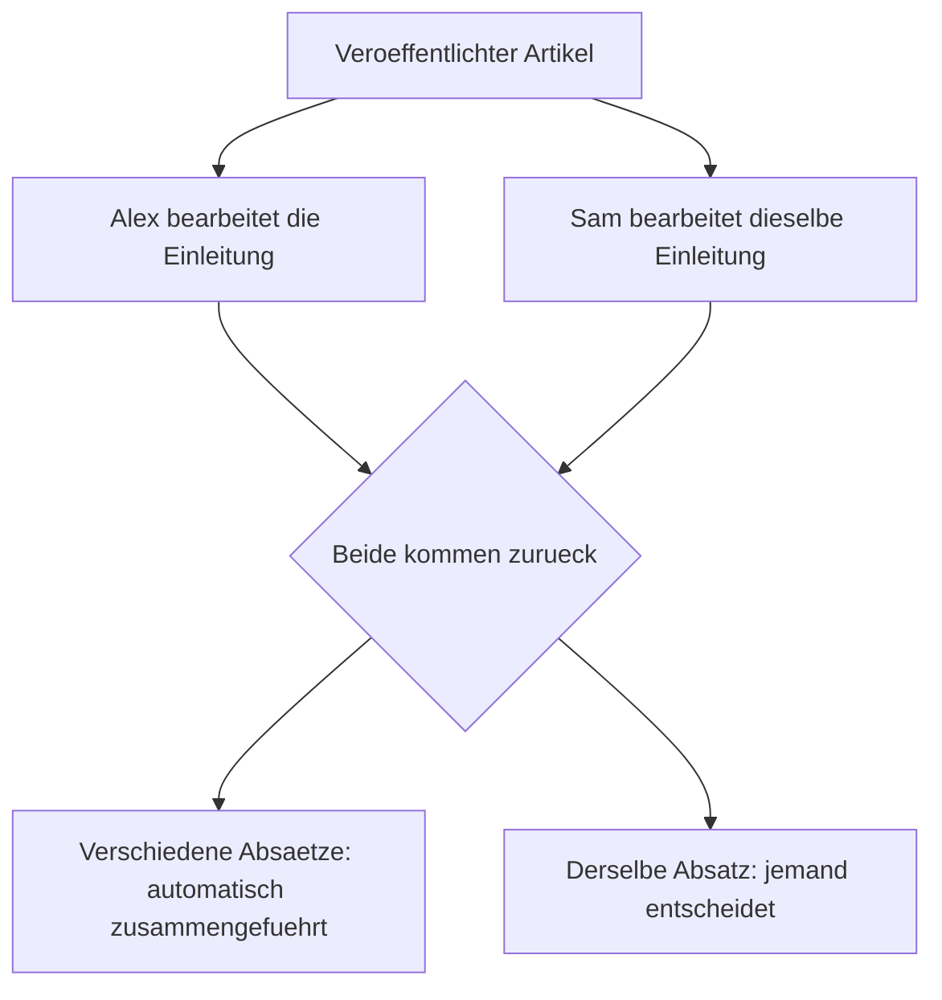

Dies ist die eine wirklich neue Idee, die der Git-gestützte Projekttyp einer Autorin zumutet, und sie
ist kleiner als ihr Ruf.

## Warum es überhaupt passiert

Zwei Personen können gleichzeitig an zwei Orten am selben Artikel arbeiten, weil der Inhalt aus
Dateien besteht und Dateien kopiert werden können. Wenn beide Arbeitsstände wieder zusammenkommen,
muss etwas entscheiden, was der Artikel nun sagt.

[d360]: # 'mermaid caption="Derselbe Artikel, zwei Branches, zwei Bearbeitungen."'

[d360]: # "/mermaid"

[d360]: # 'callout kind="success"'

> **Meistens passiert überhaupt nichts**
>
> Zwei Personen, die verschiedene Teile eines Artikels bearbeiten, werden zusammengeführt, ohne dass
> jemand gefragt wird. Ein Konflikt entsteht nur, wenn zwei Bearbeitungen dieselben Zeilen berühren,
> und das ist seltener, als es klingt.

[d360]: # "/callout"

## Was Sie tatsächlich sehen

Eine eingehende Änderung aus Git ersetzt nie das, was Sie gerade tippen. Der Git-Status zeigt
stattdessen **Updates**, und nichts bewegt sich, bis Sie sie übernehmen.

Das Übernehmen speichert zuerst Ihre Arbeit und führt dann die Git-Änderung in Ihren Entwurf ein.
Überschneiden sich die beiden nicht, ist damit Schluss. Überschneiden sie sich, öffnet sich
**Review conflicts**.

[d360]: # 'table border="all" striped="true"'

| In der Konfliktprüfung | |
| :--- | :--- |
| Für jeden Konfliktblock | Eingehendes behalten (Git), Ihres behalten (Document360) oder beides behalten — Ihres zuerst |
| Meinung geändert | Zurücknehmen |
| Fortschritt | „x von y“ und Als gelöst markieren je Artikel |
| Einen Block lesen | Jede Seite wird als formatierter Inhalt angezeigt, so wie sie später gelesen wird |

[d360]: # "/table"

> [!IMPORTANT]
> **Solange ein Konflikt ungelöst ist, geht nichts verloren**
>
> Beide Fassungen existieren, und keine wird verworfen, bis jemand die Frage beantwortet. Speichern
> und Veröffentlichen sind nicht verfügbar, bis sie gelöst sind — das ist das Produkt, das sich
> weigert, Sie auf einer unbeantworteten Frage aufbauen zu lassen.

Rein formatbezogene Unterschiede werden für Sie entschieden, und der Bildschirm sagt es. Während eine
Person einen Artikel auflöst, ist er für alle anderen gesperrt, die „{name} löst Konflikte“ sehen.

## Drei Dinge, die ohne Rückfrage aufgelöst werden

> [!CAUTION]
> **Front Matter, Snippets und Löschungen folgen Regeln statt Ihrem Urteil**
>
> Front Matter wird Schlüssel für Schlüssel zusammengeführt; wo beide Seiten dieselbe Einstellung
> geändert haben, behält Document360 seinen eigenen Wert, schreibt ihn bei der nächsten
> Veröffentlichung und sagt Ihnen, welchen. Ein auf beiden Seiten geändertes Snippet wird gar nicht
> geprüft — die Fassung von Document360 gewinnt. Und ein in Git gelöschtes Snippet wird gelöscht,
> auch wenn Artikel es noch verwenden.

Auf der einen Seite gelöscht und auf der anderen bearbeitet ist die eine Löschung, nach der Sie
gefragt werden: löschen oder den Artikel behalten.

## Die meisten vermeiden

[d360]: # 'multi-level-list styles="decimal,lower-alpha"'

1. **Halten Sie Änderungen klein und führen Sie sie schnell zusammen.** Je länger ein Branch lebt,
   desto weiter bewegt sich der veröffentlichte Inhalt darunter.
2. **Sagen Sie, woran Sie arbeiten.** Zwei Autorinnen, die am selben Nachmittag dieselbe Seite neu
   schreiben, sind ein Abstimmungsproblem, das kein Werkzeug löst.
3. **Ergänzen Sie lieber, als umzubauen.** Ein neuer Abschnitt kollidiert selten; eine umgebaute
   Seite kollidiert mit allem.
4. **Formatieren Sie keinen Text um, den Sie nicht geändert haben.**
   1. Einen Absatz neu umzubrechen lässt jede Zeile bearbeitet aussehen.
   2. Zwei Personen, die dieselbe Datei neu umbrechen, kollidieren in jeder Zeile, ohne sich
      inhaltlich zu widersprechen.

[d360]: # "/multi-level-list"

> [!CAUTION]
> **Automatisches Umformatieren ist die größte einzelne Ursache vermeidbarer Konflikte**
>
> Ein Editor, der Markdown beim Speichern neu umbricht, macht aus jeder Bearbeitung eine Bearbeitung
> der ganzen Datei. Schalten Sie es für dieses Repository ab, und die meisten Konflikte entstehen
> nicht mehr.

## Gleichzeitiges Bearbeiten und Branches

Mehrere Personen können gleichzeitig in einem Projekt arbeiten. Praktikabel bleibt das, weil jedes
Arbeitsstück einen Ort hat, an dem es liegen kann — einen Branch — und weil Kollisionen erkannt
werden, wenn Arbeit wieder zusammenkommt, statt stillschweigend zu jemandes Gunsten aufgelöst zu
werden.

> [!NOTE]
> **Erkennung an der Grenze, nicht im Editor**
>
> Zwei Personen, die im selben Moment an derselben Stelle tippen, sind eine Frage des gleichzeitigen
> Bearbeitens. Zwei Personen, die dieselbe Stelle in zwei Branches bearbeitet haben, sind eine Frage
> des Konflikts. Das sind verschiedene Probleme, und Document360 behandelt sie verschieden.

Was, wenn ich falsch auflöse?

Veröffentlichen Sie eine Korrektur. Die Historie enthält beide Originalfassungen und Ihre Auflösung,
eine falsche Entscheidung ist also auf eine Weise wiederherstellbar, wie es ein überschriebener
Datenbankeintrag nicht wäre.

Kann ein Konflikt in der Navigation auftreten?

Ja — zwei Personen, die den Baum umsortieren, bearbeiten beide `d360.json`. Es löst sich genauso auf:
Jemand entscheidet, wie die Reihenfolge sein soll. Das ist ein guter Grund, Navigationsänderungen
bewusst vorzunehmen statt als Nebenwirkung von etwas anderem.

Muss ich Git verstehen, um einen aufzulösen?

Nein. Die Frage, die Ihnen gestellt wird, lautet: „Welchen dieser beiden Absätze soll der Artikel
haben?“, und das ist eine redaktionelle Frage, die Sie besser beantworten können als jeder Entwickler.

[d360]: # 'snippet name="deleteMe"'
