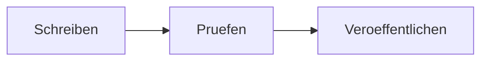

Diese Seite führt jeden Block vor, indem sie ihn verwendet. Alles, was Sie unten sehen, ist ein
Block, den Sie aus dem Menü des Editors einfügen können.

## Hinweisboxen

Acht Arten. Verwenden Sie sie für etwas, das ein Leser nicht übersehen darf, und sparsam — eine Seite
voller Hinweisboxen ist eine Seite ganz ohne Betonung.

> [!NOTE]
> **Hinweis**
>
> Kontext, den man gern hat und der nichts daran ändert, was Sie tun.

> [!TIP]
> **Tipp**
>
> Ein besserer Weg, das zu tun, was Sie ohnehin gerade tun.

[d360]: # 'callout kind="info"'

> **Info**
>
> Neutrale Information, oft zu Verfügbarkeit oder Geltungsbereich.

[d360]: # "/callout"

[d360]: # 'callout kind="success"'

> **Erfolg**
>
> Bestätigung, dass etwas funktioniert hat oder dass eine Entscheidung richtig war.

[d360]: # "/callout"

> [!IMPORTANT]
> **Wichtig**
>
> Etwas, das ändert, was der Leser tun sollte.

> [!WARNING]
> **Warnung**
>
> Etwas, das schiefgeht, wenn man es ignoriert.

> [!CAUTION]
> **Vorsicht**
>
> Ein Risiko mit Folgen über die unmittelbare Aufgabe hinaus.

[d360]: # 'callout kind="error"'

> **Fehler**
>
> Etwas Unumkehrbares oder ein Fehler, der etwas kostet.

[d360]: # "/callout"

> [!TIP]
> **Der erste fett gesetzte Absatz einer Hinweisbox wird ihr Titel**
>
> Und zwar nur dann, wenn mindestens ein weiterer Block folgt. Eine Hinweisbox, die nur aus einer
> fetten Zeile besteht, ist eine Hinweisbox mit Rumpf und ohne Titel, was meist ohnehin gemeint war.

## Aufklappbares

Ein Akkordeon, für Details, die die meisten Leser nicht brauchen:

<details>
<summary>Wie sich Akkordeons in der Suche verhalten</summary>

Eingeklappter Inhalt wird weiterhin indexiert und weiterhin gefunden. Wer aus der Suche kommt, sieht
den Abschnitt geöffnet. Etwas in einem Akkordeon zu verstecken, verbirgt es vor der Seite, nicht vor
der Suche.

</details>

Sie lassen sich verschachteln, was gelegentlich nützlich ist und schnell übertrieben wird:

<details>
<summary>Ein Akkordeon, das Akkordeons enthält</summary>

<details>
<summary>Das erste innere</summary>

Zwei Ebenen sind lesbar.

</details>

<details>
<summary>Das zweite innere</summary>

Drei sind ein Zeichen dafür, dass die Seite geteilt gehört.

</details>

</details>

## Tabs

Für dieselbe Anweisung in mehreren Zusammenhängen — Plattformen, Sprachen, Rollen:

[d360]: # "tabs"

<details>
<summary>Erster Tab</summary>

Jeder Tab ist ein `<details>` innerhalb eines Tab-Blocks.

</details>

<details>
<summary>Zweiter Tab</summary>

Leser sehen Tabs; ein schlichter Markdown-Renderer sieht einen Stapel aufklappbarer Abschnitte, was
sich immer noch richtig liest.

</details>

[d360]: # "/tabs"

## FAQ

Für echte Fragen, so formuliert, wie ein Leser sie stellen würde:

[d360]: # "faq"

<details>
<summary>Unterscheidet sich ein FAQ-Block von einem Akkordeon?</summary>

Strukturell sind beide `<details>`. Der FAQ-Block sagt Document360, dass es sich um Frage-und-
Antwort-Paare handelt, was beeinflusst, wie sie dargestellt und wie sie aufgegriffen werden.

</details>

<details>
<summary>Soll ich alles in ein FAQ packen?</summary>

Nein. Ein FAQ ist der Ort für wirklich häufige Fragen. Eine Seite, die vollständig aus FAQ besteht,
ist meist eine Seite, deren Struktur nie entschieden wurde.

</details>

[d360]: # "/faq"

## Tabellen

Eine schlichte Markdown-Tabelle:

| Block | Verwenden für |
| :--- | :--- |
| Hinweisbox | Etwas, das ein Leser nicht übersehen darf |
| Akkordeon | Details, die die meisten Leser überspringen |
| Tabs | Eine Anweisung, mehrere Zusammenhänge |

Oder eine konfigurierte, mit Rahmen und Streifen:

[d360]: # 'table border="all" striped="true"'

| Option | Wirkung |
| :--- | :--- |
| `border` | Welche Rahmen gezeichnet werden |
| `striped` | Abwechselnde Zeilenschattierung |

[d360]: # "/table"

## Code

Mit Zeilennummern, für Code, auf den Sie zeilenweise verweisen:

```json lineNumbers
{
  "serializerVersion": 1,
  "languages": [{ "code": "en", "default": true }]
}
```

Mit Umbruch, für Zeilen, die lang sind und nicht gescrollt werden sollen:

```text wordWrap
This single line is longer than the column it is displayed in, so wrapping is kinder than a horizontal scrollbar.
```

## Listen mit eigener Nummerierung

[d360]: # 'multi-level-list styles="decimal,lower-alpha"'

1. Ein nummerierter Schritt.
   1. Ein Zwischenschritt, mit Buchstaben statt Zahlen.
   2. Noch einer.
2. Der nächste Schritt.

[d360]: # "/multi-level-list"

## Diagramme

[d360]: # 'mermaid caption="Ein Diagramm wird als Text geschrieben, also verhält es sich im Diff wie Text."'



[d360]: # "/mermaid"

## Mathematik

Inline, wie in $E = mc^2$, und als Block:

$$
\sum_{i=1}^{n} x_i = x_1 + x_2 + \cdots + x_n
$$

## Medien und Anhänge

Eine Abbildung, mit Bildunterschrift:

[d360]: # 'figure align="center" width="760"'

{width="760" height="320"}

Eine Abbildung ist ein Bild plus Bildunterschrift, und die Unterschrift gehört zum Block, statt ein
Absatz darunter zu sein.

[d360]: # "/figure"

Ein Video:

[d360]: # 'video src="https://commondatastorage.googleapis.com/gtv-videos-bucket/sample/ForBiggerFun.mp4" width="720" height="405" controls="true"'

[d360]: # "/video"

Ein eingebettetes PDF:

[d360]: # 'pdf src="https://www.w3.org/WAI/ER/tests/xhtml/testfiles/resources/pdf/dummy.pdf" width="100%" height="420"'

[d360]: # "/pdf"

Eine Datei zum Herunterladen für den Leser:

[d360]: # 'file href="https://placehold.co/sample.csv" name="sample-export.csv" type="csv" size="2048"'

[d360]: # "/file"

## Trenner und Seitenumbrüche

Ein gestalteter Trenner, für einen Themenwechsel innerhalb einer Seite:

[d360]: # 'divider style="dashed"'

---

Und ein Seitenumbruch, der zählt, wenn der Artikel als PDF exportiert wird:

[d360]: # "page-break"

## Notizen, die nur Ihr Team sieht

[d360]: # "private-note"

**Intern: eine private Notiz erreicht die Knowledge-Base-Site nie**

Sie ist im Editor und im Repository sichtbar und wird aus dem ausgeschlossen, was Leser erhalten.
Nutzen Sie sie für das, was die nächste Autorin wissen muss und der Leser nicht — Zuständigkeit, ein
Vorbehalt, der Grund, warum die Seite so geschrieben ist, wie sie geschrieben ist.

[d360]: # "/private-note"

> [!WARNING]
> **Eine private Notiz ist kein Geheimnis**
>
> Sie steht im Repository, also kann jeder sie lesen, der das Repository lesen kann. Halten Sie
> Zugangsdaten und wirklich Vertrauliches heraus.

[d360]: # 'snippet name="deleteMe"'
