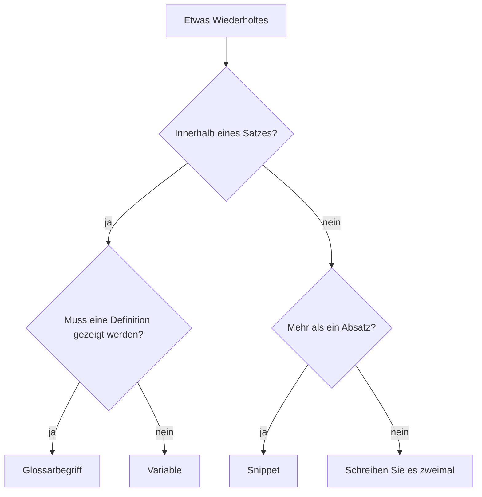

Drei Mechanismen, für drei verschiedene Größen von Sache.

[d360]: # 'table border="all" striped="true"'

| | Wiederverwendet | In diesem Projekt gespeichert als |
| :--- | :--- | :--- |
| **Snippet** | Einen Block, oder mehrere | `.document360/snippets/global/<name>.md` |
| **Variable** | Ein Wort oder einen Wert, inline | Ein Eintrag in `.document360/variables.json` |
| **Glossarbegriff** | Einen Begriff, inline, mit Definition beim Überfahren | Eine Markdown-Datei je Begriff |

[d360]: # "/table"

## Snippets

Ein Snippet ist eine Markdown-Datei mit Inhalt, den Sie in mehreren Artikeln verwenden. Ändern Sie
die Datei, und jeder Artikel, der sie einbindet, ändert sich mit.

```markdown
---
name: supportFooter
description: Where to get help, at the end of an article.
contentType: markdown
---

Content goes here, and it can contain any block.
```

Fügen Sie eines aus dem Editor ein, und der Artikel erhält eine einzige Zeile, die es beim Namen
nennt.

> [!IMPORTANT]
> **Ein Snippet ist ein Block, keine Wendung**
>
> Es wird zwischen Absätze eingefügt, nicht in einen hinein. Für etwas, das in einen Satz gehört —
> ein Produktname, eine Versionsnummer — nehmen Sie eine Variable.

## Variablen

Eine Variable ist ein benannter Wert, der überall dort eingesetzt wird, wo er vorkommt. Dieses
Projekt liefert vier mit:

| Variable | Wert |
| :--- | :--- |
| `productType` | <span data-variable="productType">{{variable.productType}}</span> |
| `siblingType` | <span data-variable="siblingType">{{variable.siblingType}}</span> |
| `editorName` | <span data-variable="editorName">{{variable.editorName}}</span> |
| `docsRoot` | <span data-variable="docsRoot">{{variable.docsRoot}}</span> |

Jede dieser Tabellenzellen *ist* die Variable, keine Kopie ihres Wertes — ändern Sie
`.document360/variables.json`, und diese Tabelle ändert sich mit.

> [!TIP]
> **Variablen sind für das, was sich ändert, nicht für jedes wiederholte Wort**
>
> Ein Produktname, den das Marketing umbenennen könnte, eine URL, die umziehen wird, eine Version,
> die Sie hochzählen werden. Gewöhnliche Substantive zu Variablen zu machen, macht das Markdown ohne
> Gegenwert schwerer lesbar.

## Glossarbegriffe

Ein Glossarbegriff markiert ein Wort in Ihrem Text und zeigt dem Leser seine Definition.

Begriffe sind Dateien wie alles andere: **eine Markdown-Datei je Begriff** im Glossarordner des
Arbeitsbereichs, benannt nach dem Slug des Begriffs. Das Front Matter trägt den Begriff und seine
Synonyme, der Textkörper die Definition, und ein Bild in der Definition ist schlichtes Markdown in
diesem Körper.

> [!IMPORTANT]
> **Glossarbegriffe synchronisieren sich in beide Richtungen, wie Snippets**
>
> Ein Begriff, den Sie in Document360 hinzufügen, ist eine ausstehende Änderung, die über die
> Veröffentlichung nach Git gelangt. Ein in Git hinzugefügter, geänderter oder gelöschter Begriff
> wird mit der Synchronisierung importiert, nach denselben Alles-oder-nichts-Regeln wie jeder andere
> Inhalt — und er kann wie jede andere Datei einen Konflikt auslösen.

Begriffe gehören zu einem Arbeitsbereich: Sie werden nur in dessen Artikeln hervorgehoben, und ein
Artikel kann nur die Begriffe seines eigenen Arbeitsbereichs verwenden.

> [!CAUTION]
> **Ein Begriff nützt nur dort, wo der Leser dem Wort begegnet**
>
> Denselben Begriff auf vierzig Seiten zu markieren, erzeugt vierzig gepunktete Unterstreichungen,
> über die niemand fährt. Markieren Sie ihn dort, wo jemand das Wort wirklich zum ersten Mal sehen
> dürfte, und das ist meist sein erstes Vorkommen in einer Kategorie und nicht sein erstes Vorkommen
> auf einer Seite.

## Die Wahl zwischen den dreien

[d360]: # 'mermaid caption="Arbeiten Sie sich hier hinunter, und Sie wählen das Richtige."'



[d360]: # "/mermaid"

> [!NOTE]
> **„Schreiben Sie es zweimal“ ist eine echte Antwort**
>
> Zwei Kopien eines Satzes kosten nichts an Pflege. Wiederverwendung rechtfertigt ihre Komplexität
> bei drei oder vier Verwendungen, nicht bei zweien, und ein Projekt mit vierzig Snippets ist
> schwerer zu bearbeiten als eines mit acht.

## Wiederverwendung und Prüfung

Weil Snippets und Variablen Dateien sind, ist eine Änderung daran eine Änderung in einem Branch, die
wie jede andere geprüft wird. Das ist der Vorteil und zugleich das, worauf zu achten ist:

> [!CAUTION]
> **Ein Snippet zu ändern ändert jeden Artikel, der es verwendet**
>
> Der Diff zeigt eine Datei. Die Wirkung betrifft zwanzig Seiten. Wenn Sie eine Snippet-Änderung
> prüfen, sehen Sie nach, wo es verwendet wird, bevor Sie sie genehmigen — eine Formulierung, die in
> einen Artikel passt, kann in einem anderen falsch sein.

[d360]: # 'snippet name="deleteMe"'
